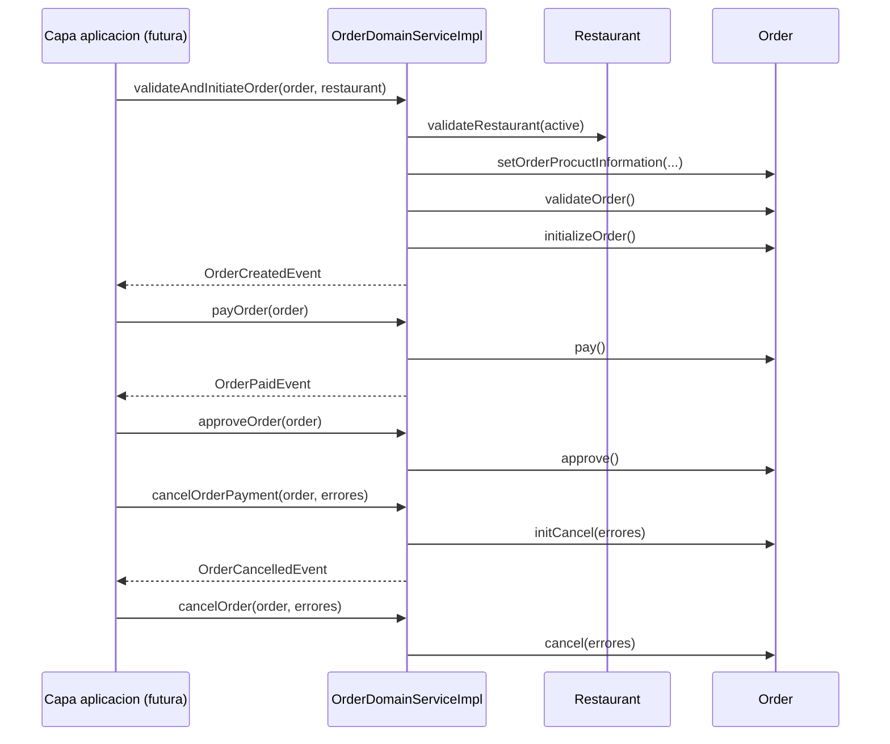

# Food Ordering System - Arquitectura detallada

Fecha: 2026-11-08  
Raiz analizada: `food-ordering-system/` (exclusiva)

## 0. Alcance y metodo

Este documento se construye **solo** a partir del codigo real presente en la raiz indicada:

- `pom.xml` y POMs de submodulos
- codigo Java en `common/common-domain` y `order-service/**`
- estado actual de `docs/`

### Supuestos explicitos

1. No se infiere comportamiento fuera del codigo actual (no se asume infraestructura externa ni servicios no implementados).
2. Los modulos con `org.example.Main` se consideran esqueletos sin funcionalidad de negocio.
3. El flujo end-to-end se describe segun los metodos y eventos existentes en `order-domain-core`, aunque hoy no esta cableado en adaptadores de entrada/salida.

---

## 1. Arquitectura por modulos (Maven)

## 1.1 Mapa de modulos

```text
food-ordering-system (pom)
|- common (pom)
|  `- common-domain (jar)
`- order-service (pom)
   |- order-domain (pom)
   |  |- order-domain-core (jar)
   |  `- order-application-service (jar)
   |- order-application (jar)
   |- order-data-access (jar)
   |- order-messaging (jar)
   `- order-container (jar)
```

## 1.2 Responsabilidad de cada modulo

| Modulo | Rol | Estado actual |
|---|---|---|
| `common/common-domain` | Bloques base DDD compartidos (Entity, AggregateRoot, IDs, Money, estados, excepciones, DomainEvent) | Implementado |
| `order-service/order-domain/order-domain-core` | Modelo de dominio de ordenes: agregado `Order`, reglas, transiciones, eventos de dominio y value objects propios | Implementado (parcial) |
| `order-service/order-domain/order-application-service` | Contratos/DTOs de entrada-salida para casos de uso y mensajes | Implementado (DTOs) |
| `order-service/order-application` | Capa aplicacion (handlers/orquestacion) | Esqueleto (`Main`) |
| `order-service/order-data-access` | Persistencia/adaptadores de datos | Esqueleto (`Main`) |
| `order-service/order-messaging` | Integracion asincrona/publicacion-consumo | Esqueleto (`Main`) |
| `order-service/order-container` | Composicion/arranque del servicio | Esqueleto (`Main`) |

## 1.3 Dependencias entre modulos

Dependencias observadas en POMs:

- `order-domain-core` -> `common-domain`
- `order-application-service` -> `order-domain-core`, `common-domain`
- `order-application` -> `order-application-service`
- `order-data-access` -> `order-application-service`
- `order-messaging` -> `order-application-service`
- `order-container` -> `order-domain-core`, `order-application-service`, `order-application`, `order-data-access`, `order-messaging`

Lectura arquitectonica: `common-domain` y `order-domain-core` concentran la logica real; el resto define estructura para capas de aplicacion e infraestructura.

---

## 2. Jerarquia de paquetes y subpaquetes

## 2.1 Mapa jerarquico de paquetes

```text
com.food.ordering.system
|- Main
|- domain
|  |- entity
|  |  |- AggregateRoot
|  |  `- BaseEntity
|  |- event
|  |  `- DomainEvent
|  `- exception
|     `- DomainException
`- valueobject
   |- BaseId
   |- CustomerId
   |- Money
   |- OrderApprovalStatus
   |- OrderId
   |- OrderStatus
   |- PaymentStatus
   |- ProductId
   `- RestaurantId

com.food.ordering.system.order.service.domain.dto.create
|- CreateOrderCommand
|- CreateOrderResponse
|- OrderAddress
`- OrderItem

com.food.ordering.system.order.service.domain.dto.message
|- PaymentResponse
`- RestaurantApprovalResponse

com.food.ordering.system.order.service.domain.dto.track
|- TrackOrderQuery
`- TrackOrderResponse

com.food.ordering.system.order.service.domain.dto.domain
|- OrderDomainService
`- OrderDomainServiceImpl

com.food.ordering.system.order.service.domain.dto.domain.entity
|- Customer
|- Order
|- OrderItem
|- Product
`- Restaurant

com.food.ordering.system.order.service.domain.dto.domain.event
|- OrderCancelledEvent
|- OrderCreatedEvent
|- OrderEvent
`- OrderPaidEvent

com.food.ordering.system.order.service.domain.dto.domain.exception
`- OrderDomainException

com.food.ordering.system.order.service.domain.dto.domain.valueobject
|- OrderItemId
|- StreetAddress
`- TrackingId

org.example
`- Main (uno por modulo esqueleto: application, data-access, messaging, container, domain-core)
```

## 2.2 Tabla por paquete

| Paquete | Responsabilidad | Tipos contenidos | Dependencias relevantes |
|---|---|---|---|
| `com.food.ordering.system.domain.entity` | Base DDD para entidades y agregados | `BaseEntity`, `AggregateRoot` | `java.util.Objects` |
| `com.food.ordering.system.domain.event` | Contrato marcador de eventos de dominio | `DomainEvent` | - |
| `com.food.ordering.system.domain.exception` | Excepcion base de dominio | `DomainException` | `RuntimeException` |
| `com.food.ordering.system.valueobject` | IDs tipados, dinero y estados compartidos | `BaseId`, `Money`, `*Id`, enums de estado | `BigDecimal`, `UUID` |
| `...dto.create` | DTOs para crear ordenes | `CreateOrderCommand`, `CreateOrderResponse`, `OrderAddress`, `OrderItem` | Lombok, `OrderStatus`, `UUID` |
| `...dto.message` | DTOs de respuesta desde pagos/restaurante | `PaymentResponse`, `RestaurantApprovalResponse` | `PaymentStatus`, `Instant` |
| `...dto.track` | DTOs de seguimiento de orden | `TrackOrderQuery`, `TrackOrderResponse` | `OrderStatus`, `UUID` |
| `...dto.domain` | Servicio de dominio para transiciones de estado | `OrderDomainService`, `OrderDomainServiceImpl` | entidades de dominio, eventos |
| `...dto.domain.entity` | Modelo del agregado de orden y entidades relacionadas | `Order`, `OrderItem`, `Product`, `Restaurant`, `Customer` | `common-domain`, value objects propios |
| `...dto.domain.event` | Eventos de dominio de orden | `OrderEvent`, `OrderCreatedEvent`, `OrderPaidEvent`, `OrderCancelledEvent` | `DomainEvent<Order>` |
| `...dto.domain.exception` | Excepcion especifica del dominio order | `OrderDomainException` | `DomainException` |
| `...dto.domain.valueobject` | Value objects propios de order | `TrackingId`, `OrderItemId`, `StreetAddress` | `BaseId`, `UUID` |
| `org.example` | Entry points temporales por modulo | `Main` | `System.out` |

---

## 3. Ficha por tipo (clase, interfaz, enum, record)

Nota: no se encontraron `record` en el codigo actual.

## 3.1 `common-domain`

### `com.food.ordering.system.Main` (class)
- Proposito: punto de entrada placeholder del modulo `common-domain`.
- Entradas/salidas: sin entradas; imprime mensaje fijo.
- Reglas: no aplica negocio.
- Dependencias: JDK basica (`System.out`).

### `com.food.ordering.system.domain.entity.BaseEntity<ID>` (abstract class)
- Proposito: base para entidades con identidad tipada.
- Entradas/salidas: `setId(ID)` y `getId()`.
- Reglas: `equals`/`hashCode` por `id` y clase concreta.
- Dependencias: `Objects`.

### `com.food.ordering.system.domain.entity.AggregateRoot<ID>` (abstract class)
- Proposito: marcar una entidad como raiz de agregado.
- Entradas/salidas: hereda de `BaseEntity`.
- Reglas: define limite conceptual del agregado (sin metodos propios).
- Dependencias: `BaseEntity`.

### `com.food.ordering.system.domain.event.DomainEvent<T>` (interface)
- Proposito: contrato marcador para eventos de dominio.
- Entradas/salidas: no define metodos.
- Reglas: tipado por agregado/entidad origen.
- Dependencias: genericos Java.

### `com.food.ordering.system.domain.exception.DomainException` (class)
- Proposito: excepcion base para violaciones de reglas de dominio.
- Entradas/salidas: constructores con mensaje y causa opcional.
- Reglas: unchecked exception.
- Dependencias: `RuntimeException`.

### `com.food.ordering.system.valueobject.BaseId<T>` (abstract class)
- Proposito: encapsular ids tipados con igualdad por valor.
- Entradas/salidas: constructor protegido y `getValue()`.
- Reglas: inmutable (`value` final).
- Dependencias: `Objects`.

### `com.food.ordering.system.valueobject.CustomerId` (class)
- Proposito: id tipado de cliente.
- Entradas/salidas: constructor protegido con `UUID`.
- Reglas: hereda semantica de `BaseId`.
- Dependencias: `UUID`, `BaseId<UUID>`.

### `com.food.ordering.system.valueobject.ProductId` (class)
- Proposito: id tipado de producto.
- Entradas/salidas: constructor protegido con `UUID`.
- Reglas: hereda semantica de `BaseId`.
- Dependencias: `UUID`, `BaseId<UUID>`.

### `com.food.ordering.system.valueobject.RestaurantId` (class)
- Proposito: id tipado de restaurante.
- Entradas/salidas: constructor protegido con `UUID`.
- Reglas: hereda semantica de `BaseId`.
- Dependencias: `UUID`, `BaseId<UUID>`.

### `com.food.ordering.system.valueobject.OrderId` (class)
- Proposito: id tipado de orden.
- Entradas/salidas: constructor publico con `UUID`.
- Reglas: hereda semantica de `BaseId`.
- Dependencias: `UUID`, `BaseId<UUID>`.

### `com.food.ordering.system.valueobject.Money` (class)
- Proposito: value object monetario y operaciones aritmeticas del dominio.
- Entradas/salidas: `add`, `substract`, `multiply`, comparaciones, `getAmount`.
- Reglas: inmutable; usa escala 2 y `HALF_EVEN` en resultados.
- Dependencias: `BigDecimal`, `RoundingMode`.
- Observacion de codigo: `substract(Money)` actualmente resta `this.amount - this.amount` (usa `getAmount()` propio), por lo que devuelve cero.

### `com.food.ordering.system.valueobject.OrderApprovalStatus` (enum)
- Proposito: estado de aprobacion externa del restaurante.
- Valores: `APPROVED`, `REJECTED`.

### `com.food.ordering.system.valueobject.OrderStatus` (enum)
- Proposito: maquina de estados de una orden.
- Valores: `PENDING`, `PAID`, `APPROVED`, `CANCELLING`, `CANCELLED`.

### `com.food.ordering.system.valueobject.PaymentStatus` (enum)
- Proposito: resultado de pago.
- Valores: `COMPLETED`, `CANCELLED`, `FAILED`.

## 3.2 `order-domain-core`

### `com.food.ordering.system.order.service.domain.dto.domain.OrderDomainService` (interface)
- Proposito: contrato de operaciones de dominio sobre `Order`.
- Entradas/salidas:
  - `validateAndInitiateOrder(Order, Restaurant)` -> `OrderCreatedEvent`
  - `payOrder(Order)` -> `OrderPaidEvent`
  - `approveOrder(Order)` -> `void`
  - `cancelOrderPayment(Order, List<String>)` -> `OrderCancelledEvent`
  - `cancelOrder(Order, List<String>)` -> `void`
- Reglas: la capa aplicacion publica eventos luego de persistir.
- Dependencias: entidades y eventos de order.

### `com.food.ordering.system.order.service.domain.dto.domain.OrderDomainServiceImpl` (class)
- Proposito: implementacion concreta de transiciones de orden.
- Entradas/salidas: implementa interfaz anterior.
- Reglas:
  - valida restaurante activo (`validateRestaurant`)
  - sincroniza nombre/precio de productos del pedido con menu de restaurante (`setOrderProcuctInformation`)
  - crea eventos con timestamp UTC.
- Dependencias: `Order`, `Restaurant`, `Product`, eventos, `ZonedDateTime`, `lombok @Log`.

### `com.food.ordering.system.order.service.domain.dto.domain.entity.Customer` (class)
- Proposito: agregado de cliente simplificado para asociar orden.
- Entradas/salidas: constructor `(CustomerId, username)`; getter `username`.
- Reglas: identidad por `CustomerId`.
- Dependencias: `AggregateRoot<CustomerId>`.

### `com.food.ordering.system.order.service.domain.dto.domain.entity.Product` (class)
- Proposito: entidad producto usada dentro de orden/restaurante.
- Entradas/salidas: constructor `(ProductId, name, Money)`; actualizacion `updateWithConfirmedNameAndPrice`.
- Reglas: nombre/precio pueden reemplazarse con datos confirmados del restaurante.
- Dependencias: `BaseEntity<ProductId>`, `Money`.

### `com.food.ordering.system.order.service.domain.dto.domain.entity.OrderItem` (class)
- Proposito: linea de detalle dentro de una orden.
- Entradas/salidas: inicializacion interna de ids; validacion `isPriceValid`.
- Reglas:
  - `price > 0`
  - `price == product.price`
  - `price * quantity == subtotal`
- Dependencias: `OrderId`, `OrderItemId`, `Product`, `Money`.

### `com.food.ordering.system.order.service.domain.dto.domain.entity.Restaurant` (class)
- Proposito: agregado de restaurante con estado activo y catalogo de productos.
- Entradas/salidas: builder con `restaurantId`, `active`, `products`.
- Reglas: la validacion del flujo exige `active=true`.
- Dependencias: `AggregateRoot<RestaurantId>`, `Product`.

### `com.food.ordering.system.order.service.domain.dto.domain.entity.Order` (class)
- Proposito: agregado principal de pedido.
- Entradas/salidas:
  - ciclo de vida: `initializeOrder`, `validateOrder`, `pay`, `approve`, `initCancel`, `cancel`
  - getters de estado e identidad
  - builder para creacion
- Reglas de negocio:
  1. inicializacion valida: no debe tener `id` ni `orderStatus` previos.
  2. precio total debe ser mayor que cero.
  3. `price` debe coincidir con suma de subtotales.
  4. transiciones:
     - `PENDING -> PAID`
     - `PAID -> APPROVED`
     - `PAID|PENDING -> CANCELLING`
     - `CANCELLING|PENDING -> CANCELLED`
  5. cada item se inicializa con `OrderId` y `OrderItemId` secuencial.
- Dependencias: `common-domain` IDs/estados/money, `StreetAddress`, `TrackingId`, `OrderDomainException`.

### `com.food.ordering.system.order.service.domain.dto.domain.event.OrderEvent` (abstract class)
- Proposito: base para eventos de orden con payload y timestamp.
- Entradas/salidas: `getOrder()`, `getCreatedAt()`.
- Reglas: implementa `DomainEvent<Order>`.
- Dependencias: `Order`, `ZonedDateTime`.

### `com.food.ordering.system.order.service.domain.dto.domain.event.OrderCreatedEvent` (class)
- Proposito: representa alta/inicio de orden.
- Entradas/salidas: constructor `(Order, ZonedDateTime)`.
- Reglas: especializacion sin campos extra.
- Dependencias: `OrderEvent`.

### `com.food.ordering.system.order.service.domain.dto.domain.event.OrderPaidEvent` (class)
- Proposito: representa pago exitoso de orden.
- Entradas/salidas: constructor `(Order, ZonedDateTime)`.
- Reglas: especializacion sin campos extra.
- Dependencias: `OrderEvent`.

### `com.food.ordering.system.order.service.domain.dto.domain.event.OrderCancelledEvent` (class)
- Proposito: representa cancelacion/compensacion de orden.
- Entradas/salidas: constructor `(Order, ZonedDateTime)`.
- Reglas: especializacion sin campos extra.
- Dependencias: `OrderEvent`.

### `com.food.ordering.system.order.service.domain.dto.domain.exception.OrderDomainException` (class)
- Proposito: error especifico del bounded context de orden.
- Entradas/salidas: constructores con mensaje y causa.
- Reglas: hereda de `DomainException`.
- Dependencias: `common-domain`.

### `com.food.ordering.system.order.service.domain.dto.domain.valueobject.TrackingId` (class)
- Proposito: identificador externo para seguimiento de orden.
- Entradas/salidas: constructor con `UUID`.
- Reglas: value object tipado.
- Dependencias: `BaseId<UUID>`.

### `com.food.ordering.system.order.service.domain.dto.domain.valueobject.OrderItemId` (class)
- Proposito: identificador de item dentro de orden.
- Entradas/salidas: constructor con `Long`.
- Reglas: value object tipado.
- Dependencias: `BaseId<Long>`.

### `com.food.ordering.system.order.service.domain.dto.domain.valueobject.StreetAddress` (class)
- Proposito: direccion de entrega inmutable.
- Entradas/salidas: constructor `(UUID id, street, postalCode, city)` y getters.
- Reglas: igualdad por todos sus campos.
- Dependencias: `UUID`, `Objects`.

### `org.example.Main` en `order-domain-core` (class)
- Proposito: placeholder tecnico del modulo.
- Entradas/salidas: imprime mensaje fijo.
- Reglas: sin negocio.

## 3.3 `order-application-service` (DTOs)

### `...dto.create.CreateOrderCommand` (class)
- Proposito: comando de entrada para crear orden.
- Entradas/salidas: `customerId`, `restaurantId`, `price`, `items`, `address`.
- Reglas: campos `@NonNull` (Lombok).
- Dependencias: `UUID`, `BigDecimal`, DTOs `OrderItem` y `OrderAddress`.

### `...dto.create.OrderItem` (class)
- Proposito: item de entrada en comando de creacion.
- Entradas/salidas: `productId`, `quantity`, `price`, `subtotal`.
- Reglas: `@NonNull`.
- Dependencias: `UUID`, `BigDecimal`.

### `...dto.create.OrderAddress` (class)
- Proposito: direccion de entrada para creacion.
- Entradas/salidas: `street`, `postalCode`, `city`.
- Reglas: `@NonNull`.
- Dependencias: Lombok.

### `...dto.create.CreateOrderResponse` (class)
- Proposito: respuesta al crear orden.
- Entradas/salidas: `orderTrackingId`, `orderStatus`, `message`.
- Reglas: usa `@NotNull`.
- Dependencias: `OrderStatus`, `UUID`.

### `...dto.track.TrackOrderQuery` (class)
- Proposito: consulta de tracking por id.
- Entradas/salidas: `orderTrackingId`.
- Reglas: `@NotNull`.
- Dependencias: `UUID`.

### `...dto.track.TrackOrderResponse` (class)
- Proposito: respuesta de tracking de orden.
- Entradas/salidas: `orderTrackingId`, `orderStatus`, `failureMessages`.
- Reglas: `@NotNull`.
- Dependencias: `OrderStatus`, `UUID`, `List<String>`.

### `...dto.message.PaymentResponse` (class)
- Proposito: mensaje de salida/entrada desde subsistema de pagos.
- Entradas/salidas: ids (`id`, `sagaId`, `orderId`, etc.), `price`, `createdAt`, `paymentStatus`, errores.
- Reglas: estructura de transporte, sin logica.
- Dependencias: `PaymentStatus`, `Instant`, `BigDecimal`.

### `...dto.message.RestaurantApprovalResponse` (class)
- Proposito: mensaje de aprobacion/rechazo de restaurante.
- Entradas/salidas: ids, `createdAt`, `failureMessages`.
- Reglas: estructura de transporte, sin logica.
- Dependencias: `Instant`, `List<String>`.

## 3.4 Modulos esqueletos

### `org.example.Main` en `order-application` (class)
- Proposito: placeholder tecnico del modulo.

### `org.example.Main` en `order-data-access` (class)
- Proposito: placeholder tecnico del modulo.

### `org.example.Main` en `order-messaging` (class)
- Proposito: placeholder tecnico del modulo.

### `org.example.Main` en `order-container` (class)
- Proposito: placeholder tecnico del modulo.

---

## 4. Flujo funcional end-to-end (estado actual)

## 4.1 Flujo principal implementado en dominio



## 4.2 Reglas por etapa

1. **Create order**
   - valida restaurante activo.
   - sincroniza productos de la orden con nombre/precio de catalogo del restaurante.
   - valida invariantes del agregado (`price > 0`, suma de subtotales, estado inicial).
   - asigna `OrderId`, `TrackingId`, `OrderStatus.PENDING` e ids de items.
   - retorna `OrderCreatedEvent`.

2. **Validacion de restaurante**
   - `OrderDomainServiceImpl.validateRestaurant` lanza `IllegalStateException` si `restaurant.active == false`.

3. **Aprobacion**
   - `approveOrder` exige estado `PAID`; si no, `OrderDomainException`.

4. **Pago**
   - `payOrder` exige estado `PENDING`; si no, `OrderDomainException`.
   - retorna `OrderPaidEvent`.

5. **Cancelacion / compensacion**
   - `cancelOrderPayment`: mueve a `CANCELLING` desde `PENDING` o `PAID`, agrega mensajes de fallo, retorna `OrderCancelledEvent`.
   - `cancelOrder`: mueve a `CANCELLED` desde `CANCELLING` o `PENDING`, agrega mensajes.

6. **Eventos y mensajeria**
   - eventos de dominio existentes: `OrderCreatedEvent`, `OrderPaidEvent`, `OrderCancelledEvent`.
   - no hay publicadores/consumidores implementados en `order-messaging` (modulo placeholder).

## 4.3 Alcance no implementado aun

- No hay handlers de casos de uso en `order-application`.
- No hay repositorios/mapeos en `order-data-access`.
- No hay wiring de Spring Boot en `order-container`.
- No hay pipeline real de publicacion de eventos a broker.

---

## 5. Observaciones tecnicas puntuales (basadas en codigo)

1. La nomenclatura de paquetes incluye `...dto.domain...` para entidades/eventos de dominio; funcionalmente opera, aunque mezcla semantica de DTO y dominio.
2. `CustomerId`, `ProductId` y `RestaurantId` tienen constructor `protected`; su creacion directa fuera del paquete no esta expuesta.
3. `Money.substract(Money)` usa `this.amount.subtract(getAmount())`, lo que en la practica devuelve `0.00` para cualquier entrada.
4. `OrderDomainServiceImpl` usa `IllegalStateException` para restaurante inactivo (no `OrderDomainException`).

---

## 6. Glosario

- **Aggregate Root**: entidad principal que garantiza invariantes de su agregado.
- **Bounded Context**: limite semantico donde un modelo de dominio tiene significado consistente.
- **DTO (Data Transfer Object)**: estructura de datos para transporte entre capas/modulos, sin logica de negocio.
- **Domain Event**: hecho del negocio ocurrido en el dominio, potencialmente publicable.
- **Invariante**: regla que siempre debe cumplirse para que el agregado sea valido.
- **Value Object**: objeto inmutable definido por sus valores, no por identidad.
- **Compensacion**: accion de reversa/cancelacion ante fallo en un flujo distribuido (ej. pago/aprobacion).

---

## 7. Trazabilidad rapida de ubicaciones clave

- Dominio base compartido: `common/common-domain/src/main/java/com/food/ordering/system`
- Dominio de orden y reglas: `order-service/order-domain/order-domain-core/src/main/java/com/food/ordering/system/order/service/domain/dto/domain`
- DTOs de aplicacion/mensajeria: `order-service/order-domain/order-application-service/src/main/java/com/food/ordering/system/order/service/domain/dto`
- Modulos infraestructura (esqueleto):
  - `order-service/order-application/src/main/java/org/example/Main.java`
  - `order-service/order-data-access/src/main/java/org/example/Main.java`
  - `order-service/order-messaging/src/main/java/org/example/Main.java`
  - `order-service/order-container/src/main/java/org/example/Main.java`

